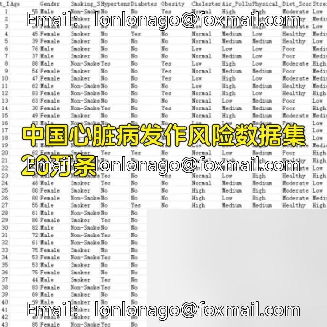
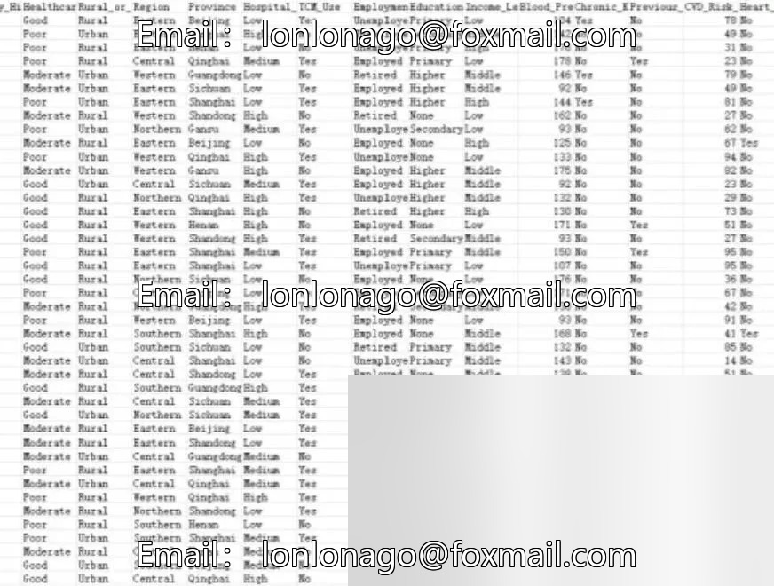

# China heart attack risk dataset

## Body

Chinese heart attack risk dataset

The dataset analyzes risk factors for heart disease outbreaks in the Chinese population, reflecting factors such as medical care accessibility, lifestyle choices, air pollution exposure, and regional differences. The data covers key variables including age, gender, smoking habits, blood pressure, cholesterol levels, and a history of heart disease outbreaks.

Considering the disparities in urban and rural medical care and environmental factors, this dataset is very suitable for cardiovascular disease prediction modeling, risk assessment, and epidemiological research.

Data volume: over 200,000

Columns to include:
Patient ID (unique identifier)
Age (number)
Gender (male/female)
Smoking status (smoking/not smoking)
Hypertension (yes/no)
Diabetes (yes/no)
Obesity (yes/no)
Cholesterol level (high/normal/low)
……

Main highlights:
Regional differences: Covering all provinces in China, taking into account different medical infrastructure.
Main risk factors: smoking, air pollution, diet, and stress levels.
Medical accessibility: Distinguishing medical conditions in cities and rural areas.
Heart attack prediction: Can be used to develop heart attack prediction models.

web-based shipment, can be directly photographed and shipped.

The dataset covers risk factors for heart attack in China, including age, gender, smoking habits, blood pressure, cholesterol levels, obesity, air pollution exposure, diet and stress; it also includes urban and rural healthcare indicators.

<!-- AI_ENRICHED -->

## Images

## Payment

Here is a pay link on Stripe ( https://buy.stripe.com/3cs8yP7sY87d0vu9AB ). Please contact me lonlonago@foxmail.com after funding $89, and I will send you a complete data files , thank you!

